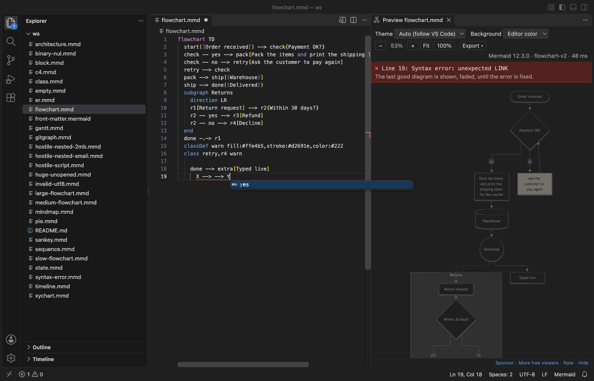
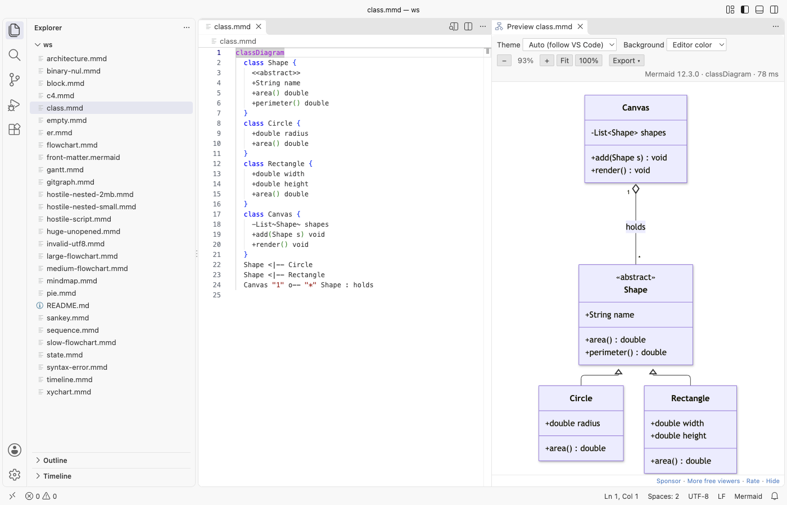

# Mermaid Viewer & Mermaid Preview

Free, no sign-in, works offline. A live Mermaid preview for `.mmd` files and for `mermaid` blocks in Markdown, with zoom, pan and SVG or PNG export. No account, no AI and no network.


*Real output from VS Code 1.142 on macOS. The file is `sequence.mmd` from `scripts/make-samples.mjs`. `scripts/e2e-vscode.mjs` installed the packaged extension in a clean VS Code profile, opened the file and saved the window through the debug port.*

- It opens without asking you to sign in. Mermaid 12.3.0 ships inside the extension and draws in VS Code, so the preview also works behind a proxy or on a plane.
- It shows the current Mermaid. The toolbar names the version, so you know which syntax works: flowcharts, sequence, class, state, ER, Gantt, pie, gitGraph, mindmap, timeline, sankey, XY charts, block, C4, architecture and the other types Mermaid 12 knows.
- It exports the way you need. PNG at 1x, 2x or 4x with an optional largest width or height, SVG, Copy PNG to the clipboard, or Copy SVG code.

## Quick start

1. Install Mermaid Viewer.
2. Open a `.mmd` or `.mermaid` file and click the preview icon at the top right of the editor, or press `Cmd+K V` (`Ctrl+K V` on Windows and Linux).
3. Scroll to zoom at the pointer, drag to pan. Type in the file and the preview follows.

"Mermaid Viewer: Get Started" in the Command Palette opens a short tour.

## Markdown files with many diagrams


Open the preview on a Markdown file and it lists every ` ```mermaid ` and `~~~mermaid` block. Each diagram has its own error line and its own SVG, PNG and Copy PNG buttons, so one broken block does not hide the others. Click a title to jump to the block, or pick one in the list at the top to see it alone with zoom and pan. Moving the cursor into a block highlights its diagram.

## Export


| Option | What it does |
|---|---|
| Scale | 1x, 2x or 4x of the drawn size |
| Max width, Max height | Optional limits in pixels. The PNG shrinks to fit and keeps its shape. The menu shows the final size before you save. |
| Save PNG, Save SVG | A save dialog next to the source file. In Markdown, the file name gets the diagram number. |
| Copy PNG | The image goes to the clipboard, ready to paste into a chat, an issue or a slide |
| Copy SVG code | The SVG as text |

Exports use the background from the toolbar: the editor color, white, transparent or a custom color.

## Errors while you type



The preview draws again a moment after you stop typing. When the text has an error, it names the line, keeps the last good diagram on screen and adds the error to the Problems panel. Click the error to put the cursor on that line.

## Themes and background



The Mermaid theme follows VS Code: dark in dark themes, default in light ones. The toolbar also offers default, dark, forest, neutral and base. A theme set inside the diagram (front matter or `%%{init}%%`) wins. The background can be the editor color, white, transparent (shown as a checkerboard) or a custom color. Both choices are kept for each workspace.

## Big and untrusted files

- Mermaid runs with its strict security level, and a `%%{init}%%` line cannot loosen it. `click` callbacks do nothing, links are removed and HTML in labels is cleaned twice, by Mermaid and again by the viewer. The webview has no network access at all.
- Diagrams over 500,000 characters or 2,000 links are not drawn, and the preview says which limit to raise (`mermaidViewer.maxTextSize`, `mermaidViewer.maxEdges`). Mermaid's own limits are 50,000 characters and 500 links.
- A file far over the size limit is not read at all when you open its preview from the Explorer.
- Layout time grows fast with the number of links. On an M-series Mac, 600 links take about 1 second, 1,600 links about 5 seconds and 5,000 links about 54 seconds. A diagram that takes longer than 10 seconds is stopped with a message, and VS Code stays responsive. For a file like the 5,000-link one, raise both `mermaidViewer.maxEdges` and `mermaidViewer.renderTimeoutSeconds`.
- Nesting deeper than 64 levels of subgraphs is refused, because it can stall the layout for minutes.
- Files that VS Code shows as binary (a stray NUL byte, broken encoding) still preview from the editor title button or the Command Palette.

## Settings

| Setting | Default | What it does |
|---|---|---|
| `mermaidViewer.theme` | `auto` | Mermaid theme for new previews |
| `mermaidViewer.background` | `theme` | `theme`, `white`, `transparent` or `custom` |
| `mermaidViewer.customBackground` | `#f5f5f0` | The custom color |
| `mermaidViewer.wheel` | `zoom` | `pan` makes the wheel pan, and Ctrl or Cmd plus the wheel zooms |
| `mermaidViewer.updateDelayMs` | `300` | Pause after typing before the preview draws again |
| `mermaidViewer.maxTextSize` | `500000` | Largest diagram in characters |
| `mermaidViewer.maxEdges` | `2000` | Largest diagram in links |
| `mermaidViewer.renderTimeoutSeconds` | `10` | Time limit for one drawing |
| `mermaidViewer.languageIds` | `["mermaid"]` | More language ids to treat as Mermaid, for files mapped with `files.associations` |
| `mermaidViewer.askForRating` | `true` | One rating request after a few days of use |
| `mermaidViewer.showSupportLinks` | `true` | The small Sponsor and More free viewers links under the preview |

## Privacy

Mermaid Viewer sends nothing anywhere. It has no telemetry, no account and no AI. The preview page blocks every network request with its Content Security Policy, and the extension code has no network calls. Links you click in the footer (Sponsor, Rate) open in your browser.

## Limits

- Math in labels (`$$...$$`) may not look right, because the KaTeX fonts and styles are not bundled.
- Icons that Mermaid loads from the internet (icon packs for architecture diagrams) are not loaded. Built-in icons work.
- The preview does not edit the diagram. VS Code edits the text, and the preview follows.

## Support Zovo

Zovo extensions are free, with no ads and no tracking. They are made by [theluckystrike](https://github.com/theluckystrike) on GitHub. If this one saves you time, you can support the work:

- [Sponsor on GitHub](https://github.com/sponsors/theluckystrike)
- [Follow theluckystrike on GitHub](https://github.com/theluckystrike)

## More tools by Zovo

- [Graphviz Viewer & DOT Viewer (Live Preview)](https://marketplace.visualstudio.com/items?itemName=zovo.zovo-graphviz-preview) shows a live preview of DOT files and exports SVG or PNG.
- [PDF Viewer & PDF Reader](https://marketplace.visualstudio.com/items?itemName=zovo.pdf-viewer-dark) reads PDFs with a real dark mode, search, an outline and thumbnails.
- [DOCX Viewer, Word Viewer & DOCX Preview (Dark Mode)](https://marketplace.visualstudio.com/items?itemName=zovo.docx-viewer-vscode) previews Word and ODT files with dark mode, an outline and search.
- [PPTX Viewer & PPT Viewer, PowerPoint Viewer & Slideshow](https://marketplace.visualstudio.com/items?itemName=zovo.pptx-slide-viewer) shows PowerPoint slides, thumbnails and speaker notes.
- [Large JSON Viewer, JSON Browser & JSON Tree](https://marketplace.visualstudio.com/items?itemName=zovo.zovo-json-tree-viewer) shows large JSON files as a searchable tree, copies JSONPath and turns arrays of objects into a table.

See [all Zovo extensions on the Marketplace](https://marketplace.visualstudio.com/publishers/zovo).

## License

MIT. Mermaid is MIT licensed. Its bundled parts and their licenses are listed in `THIRD-PARTY-NOTICES.md`.
