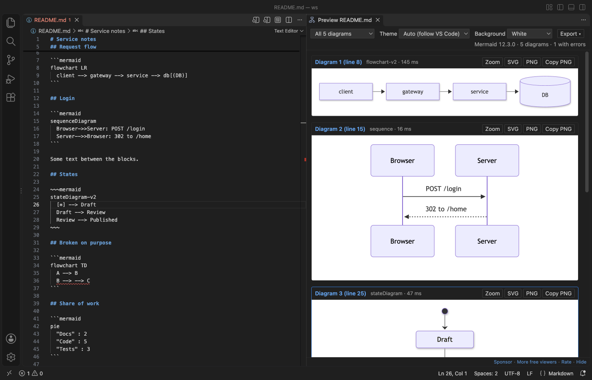
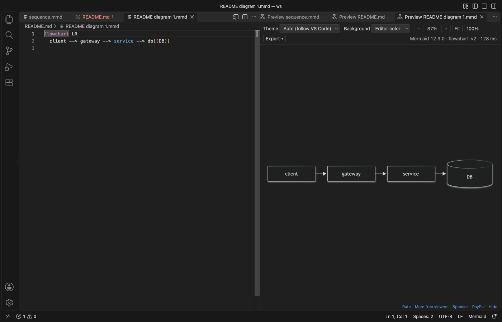
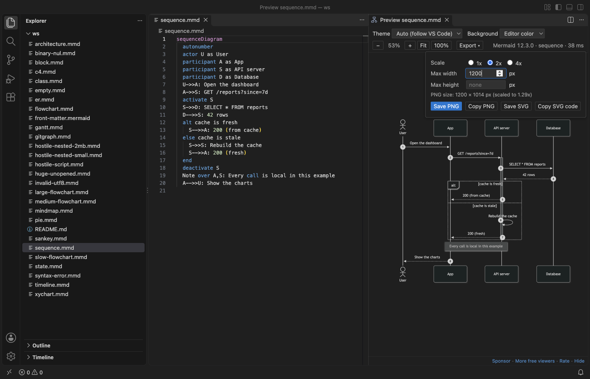

# Mermaid Diagram Viewer & Mermaid Editor, Live Mermaid Preview

Free, no sign-in, works offline. Write Mermaid on the left and see the diagram on the right while you type, in `.mmd` files and in `mermaid` blocks inside Markdown. No login, no AI, no account and no network.

Optional Zovo Pro (USD 19 once, every Zovo extension) adds PDF export with a title page, export of every diagram in the workspace, and export on save. Each Pro tool has 3 free tries. Everything that is free today stays free.


*Real output from VS Code 1.142 on macOS: `sequence.mmd` from `scripts/make-samples.mjs`, opened with "Open Diagram Editor". `scripts/e2e-editor.mjs` installed the packaged extension in a clean VS Code profile and saved the window through the debug port.*

- It edits diagrams where they live. "Edit diagram" above each ` ```mermaid ` block in a Markdown file opens that block next to a live preview. Save, and the text goes back into the Markdown file. Undo in the Markdown file takes it back.
- It helps while you type: completion for diagram types, keywords, arrows and shapes; a red underline on the line with the error; 15 starter templates.
- It exports the size you ask for: PNG at an exact width or height, or at 1x, 2x or 4x. Small SVG files, with an option for plain text labels that Azure DevOps and GitHub wikis show. Copy PNG or SVG to the clipboard. With Zovo Pro: PDF with a title page, the whole workspace at once, and fresh SVG/PNG files on every save.
- Mermaid 12.3.0 ships inside, so it draws behind a proxy or on a plane, and it never asks you to log in.

## Quick start

1. Install the extension.
2. Open a `.mmd` or `.mermaid` file and run "Mermaid Viewer: Open Diagram Editor" from the Command Palette, or click the preview icon at the top right of the editor (`Cmd+K V`, or `Ctrl+K V` on Windows and Linux).
3. In a Markdown file, click "Edit diagram" above a mermaid block.
4. No file yet? Run "Mermaid Viewer: New Diagram from Template".

"Mermaid Viewer: Get Started" in the Command Palette opens a short tour.

## Why this one

Reviews of Mermaid extensions on the Marketplace name the same problems again and again. This is what Mermaid Viewer does about each one, checked in a real VS Code with `scripts/e2e-editor.mjs`:

| What reviewers asked for | What Mermaid Viewer does (measured) |
|---|---|
| A preview without a login, including behind a company proxy ([review, Oct 2026](https://marketplace.visualstudio.com/items?itemName=MermaidChart.vscode-mermaid-chart&ssr=false#review-details); [review, Oct 2026](https://marketplace.visualstudio.com/items?itemName=MermaidChart.vscode-mermaid-chart&ssr=false#review-details)) | No account, no sign-in prompt, no AI. The whole release check made 0 network requests from the preview. |
| A way to set the PNG width or height ([review, 28 Oct 2026](https://marketplace.visualstudio.com/items?itemName=MermaidChart.vscode-mermaid-chart&ssr=false#review-details)) | Width or Height in the Export menu gives exactly that size. A width of 2,000 px gave a PNG 2,000 px wide. |
| Smaller SVG files that work in an Azure DevOps wiki (same review) | SVG export drops unused CSS and rounds coordinates: the sample flowchart went from 66 KB (Mermaid's own SVG) to 35 KB. "Text labels for wikis" writes labels as SVG text, with no HTML `foreignObject`, and the file has no remote URL. |
| No slow, pushy extras ([review, Oct 2026](https://marketplace.visualstudio.com/items?itemName=MermaidChart.vscode-mermaid-chart&ssr=false#review-details)) | No sync, no chat and no pop-ups. CodeLens shows only above ` ```mermaid ` blocks, never on other code blocks, and a setting turns it off. |
| Zoom past 500 % on large charts ([review, Mar 2026](https://marketplace.visualstudio.com/items?itemName=MermaidChart.vscode-mermaid-chart&ssr=false#review-details)) | Zoom from 1 % to 3,200 % at the pointer. Trackpad: two fingers pan, a pinch zooms. |
| Diagrams inside Markdown, not only `.mmd` files ([review](https://marketplace.visualstudio.com/items?itemName=tomoyukim.vscode-mermaid-editor&ssr=false#review-details)) | Every mermaid block of a Markdown file in one preview, and "Edit diagram" for each block. A 200-block file and the 116-block Mermaid flowchart docs page both open. |
| Labels that are not cut off ([review, Jun 2025](https://marketplace.visualstudio.com/items?itemName=tomoyukim.vscode-mermaid-editor&ssr=false#review-details)) | The release check measures every label against its box in 16 sample diagrams. |

Mermaid Viewer is an independent extension by Zovo. It is not made by, and does not replace, any other publisher's extension.

## Mermaid blocks in Markdown





- "Edit diagram" opens the block as a small `.mmd` file next to a live preview, with completion and error underlines.
- Save it, and the text goes back into its block. The Markdown file is saved too when it had no other unsaved changes. Undo in the Markdown file takes the change back.
- If the block was changed in the Markdown file in the meantime, the block editor loads the new text. If the block is gone, nothing is written and a message says why.
- "Preview" shows that one diagram with zoom and export. The preview of a whole Markdown file lists every diagram, each with its own error line and its own export buttons.
- The "Mermaid Diagrams" view in the Explorer lists the diagrams of the open file, with the heading above each one. Click a row to go there.

## Help while you type

- Completion knows the diagram types on the first line, and then the keywords, arrows and node shapes of that type: `participant`, `alt`, `->>` in a sequence diagram, `subgraph`, `classDef`, `-.->` in a flowchart, and so on.
- The preview draws again 100 ms after you stop typing. Small diagrams appear at once (15 to 200 ms for the templates); a 300-node flowchart takes Mermaid under a second to lay out. While a big diagram is still drawing, only your newest text is drawn after it, so drawings never pile up.
- An error underlines its line in red, shows in the Problems panel and at the top of the preview. The last good diagram stays on screen, faded. Click the error to jump to the line.
- "New Diagram from Template" has flowchart, sequence, class, state, ER, Gantt, pie, mindmap, timeline, gitGraph, C4, sankey, XY chart, block and architecture diagrams. In a Markdown file, the template goes in at the cursor as a mermaid block.

## Export



| Option | What it does |
|---|---|
| Scale | 1x, 2x or 4x of the drawn size |
| Width, Height | Exact size in pixels. Set one and the other follows the shape. Set both and the PNG is the largest size that fits in that box. The menu shows the final size before you save. |
| Text labels for wikis | Labels as plain SVG text instead of HTML. Use it for Azure DevOps and GitHub wikis and for tools that drop HTML in SVG. |
| Save PNG, Save SVG | A save dialog next to the source file. In Markdown, the file name gets the diagram number. |
| Copy PNG, Copy SVG code | To the clipboard, ready to paste into a chat, an issue or a slide |
| Save PDF (Pro) | Every diagram of the file in one PDF, with a title page that lists them |

Exports use the background from the toolbar: the editor color, white, transparent or a custom color. SVG files name no web fonts and load nothing from the internet.

Pro tools for docs that live in a repository:

- "Export All Diagrams in Workspace" (Pro) writes every diagram of every `.mmd`, `.mermaid` and Markdown file in the folder to SVG, PNG or both, into `mermaid-export/` with the same folders as the sources. Diagrams that cannot be drawn are listed at the end.
- "Export on Save" (Pro) keeps image files next to the source up to date. Pick SVG, PNG or both. Each time you save `flow.mmd`, `flow.svg` is written next to it; a Markdown file `README.md` gets `README-1.svg`, `README-2.svg` and so on. Only diagrams whose text changed are drawn again, so saving a long document stays fast. A small "Mermaid export" tab draws them and closes 20 seconds after the last save.
- "Save PDF" (Pro) puts every diagram of a file in one PDF with a title page.

## Zovo Pro (USD 19, paid once, for every Zovo extension)

You can use each Pro tool 3 times for free on this computer (for export on save, one window session is one try). After that, starting the tool shows one message with the ways to unlock it. There are no popups when you open a file, no ads and no countdowns, and nothing that is free today gets locked.

Zovo Pro is USD 19 once on GitHub Sponsors (the ["$19 one time" tier](https://github.com/sponsors/theluckystrike/sponsorships?tier_id=679878)). If you bought that tier, or have a monthly sponsorship of USD 10 or more that is still running, run "Zovo Pro: I already paid: unlock with GitHub Sponsors". The "$15 one time" and "$5 a month" tiers on the same page are for Obsidian plugins and do not include Zovo Pro. No GitHub account? Choose "Pay with PayPal" in the Pro message, or run "Zovo Pro: Pay for Zovo Pro with PayPal": USD 19, or USD 59 for a team of 5, at [paypal.com/paypalme/najzzz/19](https://www.paypal.com/paypalme/najzzz/19). Send the transaction ID with the short form it opens, and the license key comes by email. Run "Zovo Pro: Enter Zovo Pro license key" to add it. Turn Pro on once: the other Zovo extensions on the same computer read it from `~/.zovo/pro.json` (readable only by you; the key, or your GitHub login and tier, never a token) and are Pro too, with no second sign-in or paste. A key is checked on your computer.

To hide the Pro tools from menus and the Command Palette, set `mermaidViewer.showProFeatures` to `false`.

## Big and untrusted files

- Mermaid runs with its strict security level, and a `%%{init}%%` line cannot loosen it. `click` callbacks do nothing, `javascript:` links and remote images are removed, and HTML in labels is cleaned twice. The preview page has no network access at all.
- Diagrams over 500,000 characters or 2,000 links are not drawn, and the preview says which setting to raise. A 5 MB `.mmd` file gets that message at once. A file far over the limit is not even read when you open its preview from the Explorer.
- A 300-step sequence diagram draws in under a quarter of a second. A 2,000-node flowchart takes Mermaid about 14 seconds to lay out, and VS Code stays responsive meanwhile. A Markdown file with 200 diagrams lists all of them in about 5 seconds.
- A drawing that runs past the time limit (`mermaidViewer.renderTimeoutSeconds`, 10 seconds after the last change) is stopped with a message that names the setting.
- A diagram that takes longer than 10 seconds is stopped with a message, and VS Code stays responsive.

## Themes

The Mermaid theme follows VS Code: dark in dark themes, default in light ones. The toolbar also offers default, dark, forest, neutral and base. A theme set inside the diagram wins. The background can be the editor color, white, transparent or a custom color.

## Settings

| Setting | Default | What it does |
|---|---|---|
| `mermaidViewer.theme` | `auto` | Mermaid theme for new previews |
| `mermaidViewer.background` | `theme` | `theme`, `white`, `transparent` or `custom` |
| `mermaidViewer.customBackground` | `#f5f5f0` | The custom color |
| `mermaidViewer.wheel` | `auto` | `auto`: a mouse wheel zooms, two fingers on a trackpad pan. `zoom` or `pan` for one behavior. |
| `mermaidViewer.updateDelayMs` | `100` | Pause after typing before the preview draws again |
| `mermaidViewer.maxTextSize` | `500000` | Largest diagram in characters |
| `mermaidViewer.maxEdges` | `2000` | Largest diagram in links |
| `mermaidViewer.renderTimeoutSeconds` | `10` | Time limit for one drawing |
| `mermaidViewer.languageIds` | `["mermaid"]` | More language ids to treat as Mermaid |
| `mermaidViewer.codeLens` | `true` | "Edit diagram" and "Preview" above mermaid blocks in Markdown |
| `mermaidViewer.saveMarkdownOnBlockSave` | `true` | Save the Markdown file when you save a block, if it had no other changes |
| `mermaidViewer.svgTextLabels` | `false` | SVG export with plain text labels by default |
| `mermaidViewer.exportFolder` | `mermaid-export` | Folder for "Export All Diagrams in Workspace" |
| `mermaidViewer.exportOnSave` | `off` | Pro: `svg`, `png` or `svg+png` writes the diagrams next to the source on save |
| `mermaidViewer.showProFeatures` | `true` | Show the Pro tools and the Zovo license commands |
| `mermaidViewer.askForRating` | `true` | One rating request after some use |
| `mermaidViewer.showSupportLinks` | `true` | The small Rate, Sponsor and More free viewers links under the preview |

## Privacy

Mermaid Viewer sends nothing anywhere. It has no telemetry, no account and no AI. The preview and export pages block every network request with their Content Security Policy, and the extension makes no network calls. The one exception is when you choose "Unlock with GitHub Sponsors": it asks GitHub one question about your sponsorship. Monthly sponsors get one silent recheck every 30 days. Links you click in the footer (Rate, Sponsor) open in your browser.

## Limits

- Math in labels (`$$...$$`) may not look right, because the KaTeX fonts are not bundled.
- Icon packs that Mermaid loads from the internet are not loaded. Built-in icons work.
- PDF export puts each diagram on its own A4 page as an image.

## Support Zovo

Zovo Pro: USD 19 once, every Zovo viewer. [Get Zovo Pro on GitHub Sponsors](https://github.com/sponsors/theluckystrike/sponsorships?tier_id=679878) to turn on the Pro tools in this extension and in the other Zovo extensions you use. The free features stay free.

Zovo extensions have no ads and no tracking. They are made by [theluckystrike](https://github.com/theluckystrike) on GitHub. You can also support the work with no Pro:

- [Sponsor on GitHub](https://github.com/sponsors/theluckystrike)
- [PayPal](https://www.paypal.com/paypalme/najzzz)
- [Follow theluckystrike on GitHub](https://github.com/theluckystrike)

### Need your format supported?

Open a [format request](https://github.com/theluckystrike/mermaid-viewer-vscode/issues/new?template=format-request.yml) with a sample file, and I reply there whether it can be done. For USD 299 once, through [this GitHub Sponsors tier](https://github.com/sponsors/theluckystrike/sponsorships?tier_id=679995), I add your file format or a missing feature to this extension, with tests, within 7 days.

## More tools by Zovo

- [Graphviz Viewer & DOT Viewer (Live Preview)](https://marketplace.visualstudio.com/items?itemName=zovo.zovo-graphviz-preview) shows a live preview of DOT files and exports SVG or PNG.
- [SVG Preview & SVG Viewer (PNG Export)](https://marketplace.visualstudio.com/items?itemName=zovo.zovo-svg-viewer) previews SVG beside the editor and exports PNG; scripts never run.
- [XMind Viewer & Mind Map Viewer (XMind 8, 2020+)](https://marketplace.visualstudio.com/items?itemName=zovo.xmind-mind-map-viewer) opens XMind, FreeMind and OPML mind maps, with search and export.
- [HTML Preview & HTML Viewer (Live, CSS and Images, Offline)](https://marketplace.visualstudio.com/items?itemName=zovo.zovo-html-preview) previews HTML beside the editor with its CSS, JS and images.
- [RST Preview & reStructuredText Preview (RST Viewer, No Python)](https://marketplace.visualstudio.com/items?itemName=zovo.zovo-rst-preview) previews reStructuredText with no Python and no Sphinx.

See [all Zovo extensions on the Marketplace](https://marketplace.visualstudio.com/publishers/zovo).

## License

MIT. Mermaid is MIT licensed. Its bundled parts and their licenses are listed in `THIRD-PARTY-NOTICES.md`.
