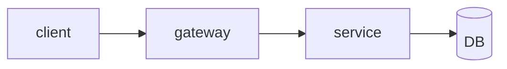
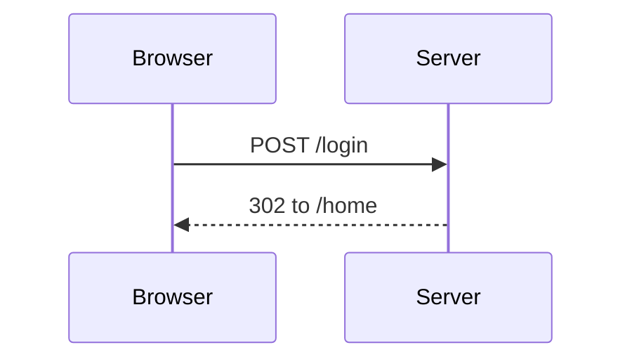
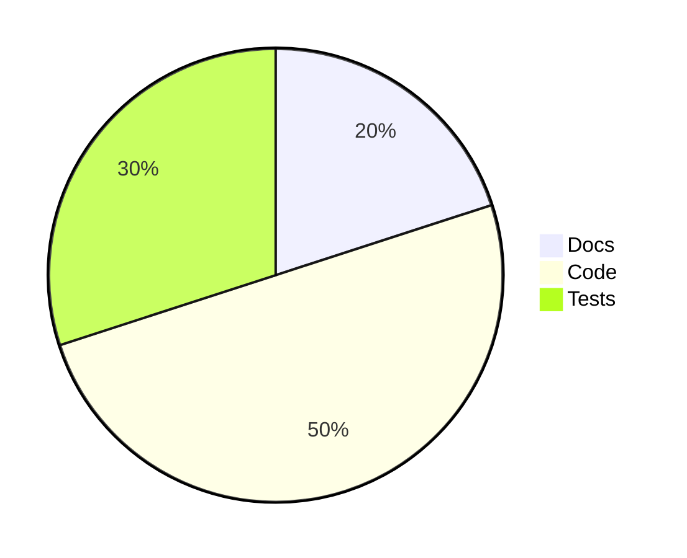

# Service notes

This file has five Mermaid blocks. The fourth one has a syntax error on purpose.

## Request flow



## Login



Some text between the blocks.

## States

~~~mermaid
stateDiagram-v2
  [*] --> Draft
  Draft --> Review
  Review --> Published
~~~

## Broken on purpose

```mermaid
flowchart TD
  A --> B
  B --> --> C
```

## Share of work



```js
// not a diagram
console.log('hello');
```
